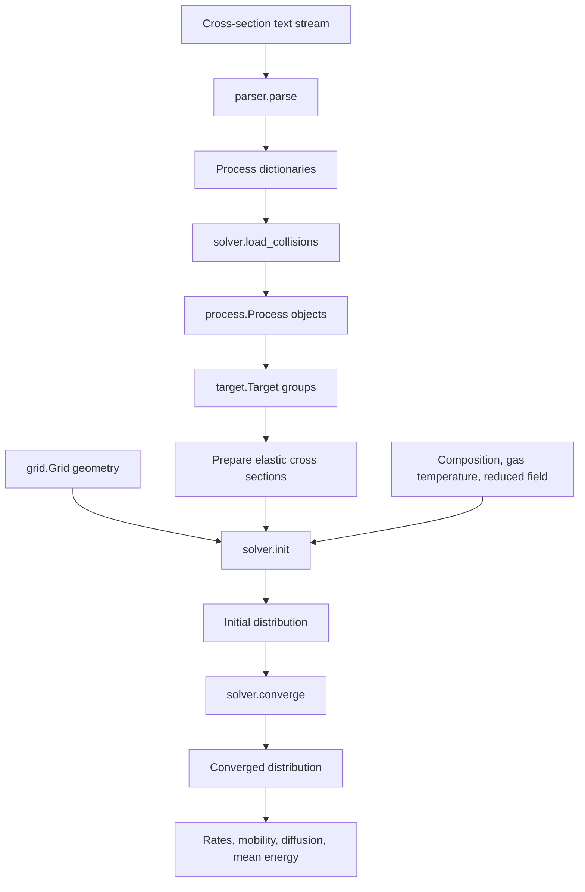

# BOLOS source code: responsibilities and execution flow

This guide explains the six Python modules in [`bolos/`](../bolos/),
the objects they exchange, and the sequence used to obtain an electron
energy distribution and derived coefficients. It describes the implementation
in this repository; function docstrings provide the detailed API examples.

## Module map

| Module | Responsibility | Main entry points |
| --- | --- | --- |
| [`__init__.py`](../bolos/__init__.py) | Define the package's public module exports. | `__all__` |
| [`parser.py`](../bolos/parser.py) | Convert a BOLSIG+-compatible text stream into process dictionaries. | `parse`, `ProcessDict` |
| [`grid.py`](../bolos/grid.py) | Construct energy cells, coordinate mappings, and distribution interpolation. | `Grid`, `MappedGrid`, concrete grid classes, `mkgrid` |
| [`process.py`](../bolos/process.py) | Represent one collision process and evaluate its collision integrals. | `Process`, `padinterp`, `int_linexp0` |
| [`target.py`](../bolos/target.py) | Group processes by gas species and prepare elastic cross sections. | `Target`, `add_process`, `ensure_elastic` |
| [`solver.py`](../bolos/solver.py) | Assemble and solve the discrete equation, then evaluate physical quantities. | `BoltzmannSolver`, `converge`, `rate`, `mobility`, `diffusion` |

The main data path is:



## Shared conventions and data

Energy is expressed in **eV**. Cross sections are supplied in **m²**.
`TOWNSEND = 1e-21` converts reduced field values in Td to SI units.

| Value | Meaning |
| --- | --- |
| `Target.density` | Gas molar fraction, despite the attribute name. It is not an absolute number density. |
| `BoltzmannSolver.kT` | Gas thermal energy in eV, normally `temperature_K * constants.k / constants.eV`. |
| `BoltzmannSolver.EN` | Reduced electric field `E/N` in V m². |
| `maxwell(kT)` argument | Electron thermal energy used to build the initial distribution; distinct from the gas temperature. |
| `f[i]` | Distribution value at the center of energy cell `i`. |

The distribution is normalized with an energy weight:

```text
integral f(E) * sqrt(E) dE = 1
```

Consequently, `f` alone is not a probability density per unit energy;
population integrals use the `sqrt(E)` weight. The code and docstrings use
the name EEDF for this stored distribution.

## `__init__.py`: package exports

This module defines the names exported by `from bolos import *`:
`solver`, `grid`, `parser`, and `process`.

It does not construct a solver, load cross sections, or start calculations.
The `target` module can also be imported explicitly when needed.

## `parser.py`: text to process definitions

### Responsibility

The parser handles the cross-section file format without constructing solver
objects. Its result is a list of ordinary dictionaries. `ProcessDict` describes
their possible fields for type checking; it does not add runtime validation.

### Processing sequence

1. `parse(fp)` scans the supplied text iterator line by line.
2. A recognized keyword selects a reader from `KEYWORDS`.
3. `_read_block()` reads the target/reaction line, an optional argument line,
   comments, and the numerical table.
4. `_read_until_sep()` consumes comments or table lines until a separator
   beginning with at least five dashes, or the end of the stream.
5. A specialized reader interprets process-specific arguments.
6. `parse()` adds the `kind` field and appends the result in file order.

| Keywords | Reader | Additional information |
| --- | --- | --- |
| `MOMENTUM`, `ELASTIC`, `EFFECTIVE` | `_read_momentum()` | Electron-to-target mass ratio. |
| `EXCITATION`, `IONIZATION` | `_read_excitation()` | Target, product, threshold, and optionally a statistical weight ratio. |
| `ATTACHMENT` | `_read_attachment()` | Optional product; threshold is set to zero. No argument line is consumed. |

The table is loaded with `numpy.loadtxt(..., ndmin=2)` and converted to nested
lists, including for a single row. `Process` performs the subsequent
cross-section shape and value checks.

Unrecognized lines outside process blocks are ignored. The caller owns and
closes the input stream. Reading a reversible arrow's weight ratio currently
requires `<->` to be a separate whitespace-delimited token. Reading this
metadata does not automatically create a reverse collision process.

## `grid.py`: energy geometry and interpolation

### Responsibility

The grid defines where distribution values are stored and where energy fluxes
are evaluated. It is independent of the gas composition and electric field.

| Attribute | Shape | Meaning |
| --- | --- | --- |
| `b` | `(n + 1,)` | Cell boundary energies. |
| `c` | `(n,)` | Arithmetic midpoints of adjacent boundaries. |
| `d` | `(n,)` | Cell widths. |
| `d32` | `(n,)` | `b[1:]**1.5 - b[:-1]**1.5`, used in population-related terms. |

### Construction sequence

`Grid(boundaries)` copies and validates finite, nonnegative, strictly increasing
boundaries, then derives the shared geometry.

`MappedGrid(x0, x1, n)` constructs boundaries through an invertible mapping:

```text
energy endpoints -> f -> uniform mapped boundaries -> finv -> Grid geometry
```

Concrete classes provide `f` and `finv`:

| Class | Grid behavior |
| --- | --- |
| `LinearGrid` | Constant energy cell widths. |
| `QuadraticGrid` | Widths increase linearly with cell index. |
| `GeometricGrid` | Each cell width is multiplied by the ratio `r`. |
| `LogGrid` | Pseudo-logarithmic spacing with a positive offset `s`. |
| `AutomaticGrid` | Redistributes boundaries using the cumulative population of a supplied distribution. |

`AutomaticGrid` uses cell weights proportional to `f0 * grid.d32`, constructs
a cumulative distribution, and interpolates its inverse. It preserves the
source cell count and energy range. Zero-population plateaus are handled by
selecting the last boundary of each plateau. Its `delta` argument is retained
for compatibility and is unused.

`mkgrid()` selects a mapped grid constructor by name or alias.

### Moving a distribution to another grid

`destination.interpolate(f, source)` interpolates source cell-center values
onto destination cell centers. Endpoint samples extend to source boundaries;
outside the source range, the result is zero. This operation does not enforce
population conservation or renormalize the result.

`cell(E)` finds the containing cell. Internal boundaries belong to the cell
on their right; the final boundary belongs to the final cell.

## `process.py`: one collision and its numerical integrals

### Construction

`Process` receives a target name, process kind, a two-column cross-section
table, and metadata such as threshold, product, and mass ratio. It:

1. Copies the table to a float64 array.
2. Rejects empty or non-two-column tables, nonfinite or negative values,
   and non-increasing energy nodes.
3. Stores the energy and cross-section columns as `x` and `y`.
4. Builds a linear interpolation object with `padinterp()`.
5. Selects electron multiplicity and energy-shift factors from the process kind.

`padinterp()` adds constant endpoint padding down to zero and up to `1e8` eV
for the intended table range. Queries outside the padded range raise an error.
The high-energy continuation is constant, rather than a physical extrapolation
model for an unknown cross section.

### Grid cache

`set_grid_cache(grid)` prepares reusable collision intervals:

1. Transform cell boundaries using
   `shift_factor * grid.b + threshold`.
2. Clip transformed boundaries slightly inside the original grid range.
3. Merge transformed boundaries, original boundaries, and cross-section nodes.
4. Interpolate the cross section at the merged nodes.
5. Store source indices `j`, destination indices `i`, interval endpoints
   `eps`, and endpoint cross sections `sigma`.

Multiple intervals may correspond to the same cell pair because cross-section
nodes can subdivide an overlap. An identical grid object reuses the cache.

The cache check uses object identity. Create and assign a new grid object when
changing geometry; modifying a grid's arrays in place does not invalidate the
process cache. Cross-section or process metadata changes likewise require
rebuilding the relevant process state.

### Collision integration

`scatterings(g, eps)` selects the local distribution slopes and reference
energies for cached source cells, then calls `int_linexp0()` for each interval.
The helper evaluates:

```text
integral from a to b of u(x) * exp(g * (x0 - x)) * x dx
```

Here `u(x)` is the linearly interpolated cross section. The helper uses
expressions based on `expm1` and an eight-point Gauss–Legendre calculation
for small dimensionless slopes to avoid cancellation near zero slope.
Nonfinite slopes retain the legacy zero contribution; nonfinite results
for finite slopes raise `FloatingPointError`.

| Kind | `in_factor` | `shift_factor` |
| --- | --- | --- |
| Excitation | 1 | 1 |
| Ionization | 2 | 2 |
| Attachment | 0 | 1 |
| Elastic / momentum / effective | 1 | 1 |

`in_factor` specifies the outgoing electron multiplicity.
`shift_factor` participates in the mapping
`incoming energy = shift_factor * outgoing energy + threshold`.

`NullProcess` is a compatibility placeholder with a zero interpolation
function. Its initializer bypasses normal `Process` construction; it is not
the standard collision-loading path used by the solver.

## `target.py`: species-level bookkeeping

### Registration sequence

`Target(name)` starts with zero molar fraction and empty process groups.
`add_process()` selects the process-kind list, checks mass-ratio consistency,
sets `process.target`, and registers the process in `by_product` for searches.
`MOMENTUM` and `EFFECTIVE` share the effective-process list.

The `inelastic` property combines attachment, ionization, and excitation.
`everything` combines elastic and inelastic processes. These properties
return new lists. `weighted_elastic` remains compatibility storage and is
not included in those normal solver groups.

### Preparing elastic cross sections

`ensure_elastic()` follows this decision sequence:

1. Reject simultaneous explicit elastic and effective processes.
2. Return immediately if explicit elastic data already exist.
3. Reject multiple effective processes for the same target.
4. If neither form exists, log a warning and return.
5. Copy the effective table and subtract interpolated inelastic cross sections.
6. Clip negative results to zero and record the affected energy range.
7. Register the derived `ELASTIC` process and clear the shared effective list.

This conversion is called by `BoltzmannSolver.load_collisions()`.
Calling `add_process()` alone does not automatically perform the conversion.

## `solver.py`: setup, iteration, and derived quantities

### Setup and initialization

`BoltzmannSolver(grid)` stores grid geometry and initializes the target lookup.
`load_collisions()` creates `Process` objects through `add_process()` and
organizes them into targets. The caller then sets gas fractions, `kT`, and `EN`.
Only targets with positive molar fractions participate in the active-process
iterators.

`init()` requires the reduced field and gas thermal energy. It aggregates
cross sections at grid boundaries, prepares collision caches, and computes:

| Coefficient | Role |
| --- | --- |
| `sigma_m` | Composition-weighted momentum-transfer cross-section sum. |
| `sigma_eps` | Elastic energy-transfer sum weighted by twice the mass ratio. |
| `W` | Elastic energy-drift coefficient. |
| `DA` | Reduced-field contribution to energy diffusion. |
| `DB` | Gas thermal contribution to energy diffusion. |

The coefficients are built as follows, with `GAMMA = sqrt(2e / m_e)`:

```text
W  = -GAMMA * E**2 * sigma_eps
DA =  GAMMA / 3 * EN**2 * E
DB =  GAMMA * kT * E**2 * sigma_eps
```

Here `E` denotes energy, not electric field. Initialization also resets
distribution-slope diagnostics and reports whether clipped elastic data
overlap the calculation's energy range.

### Initial distribution

`maxwell(kT)` samples the analytical Maxwell distribution at cell centers.
It is an initial guess; the final distribution is determined by the solver.
Its continuous formula is normalized over an infinite energy range, so its
sampled values on a finite grid need not have exactly unit numerical norm.

### One iteration

```text
iterate(f_old)
  -> _linsystem(f_old)
       -> _PQ(f_old)
            -> _g(f_old)
            -> Process.scatterings(...), for each active inelastic process
       -> _scharf_gummel(corrected_cross_section, growth_term)
  -> spsolve(I + delta*A - delta*Q, f_old)
  -> _normalized(f_new)
```

`_g()` estimates `d(log(f))/dE` from neighboring samples. It rejects nonfinite
distribution values and diagnoses negative samples or undefined tail slopes.

`_PQ()` constructs a sparse collision matrix `Q`. For each cached interval,
it adds incoming contributions at `(i, j)` and outgoing contributions at
`(j, j)`, using the process's outgoing electron multiplicity. An empty reaction
set produces a zero matrix.

`_linsystem()` obtains the net source contribution from `Q.dot(f)`, corrects
the effective momentum-transfer cross section, and constructs the growth
contribution to the transport matrix.

`_scharf_gummel()` assembles a tridiagonal Scharfetter–Gummel transport matrix
`A`. Both energy boundaries use zero-flux conditions. The update solves:

```text
(I + delta*A - delta*Q) f_new = f_old
```

`_normalized()` divides by `_norm(f)`, which uses Simpson integration of
`f * sqrt(E)` at cell centers. The collision coefficients depend on the current
distribution, so matrices are rebuilt during the iteration.

### Convergence loop

`converge()` calls `iterate()` repeatedly. Its error measure is:

```text
error = _norm(abs(f_old - f_new))
```

When two successive error estimates decrease, it adjusts `delta` using their
logarithms and the requested reduction factor `m`. `delta` controls the
iterative numerical update; `converge()` is not a physical transient simulation.

The method returns when `error < rtol`. With `full=True`, it returns
`(distribution, iteration_count, error)`. Exhausting `maxn` raises
`ConvergenceError`. This criterion measures successive-iterate change; the
caller should also assess energy-range and grid-resolution sensitivity.

### Derived quantities

| Method | Calculation | Output |
| --- | --- | --- |
| `search()` | Look up processes by target and product, or `"target -> product"`. | One process or a list. |
| `rate()` | Integrate the selected cross section against the distribution using cached collision intervals. | Rate coefficient in m³/s. |
| `mobility()` | Integrate the distribution derivative using a momentum-transfer denominator corrected for ionization and attachment. | Reduced mobility `mu*N`, in 1/(m V s). |
| `diffusion()` | Integrate the energy-weighted distribution using a similarly corrected denominator evaluated at cell centers. | Reduced diffusion `D*N`, in 1/(m s). |
| `mean_energy()` | Sum cell contributions proportional to `f * diff(b**2.5)`. | Mean energy in eV. |

`rate(..., weighted=True)` additionally multiplies by the target molar fraction.
It does not multiply by the absolute gas number density.

The default collision matrix uses all active inelastic processes. Mobility
and diffusion request only ionization and attachment when evaluating their
net growth correction. `iter_momentum()` otherwise delegates to `iter_all()`.

The implementation uses different integration constructions for normalization,
collision rates, and mean energy. They should not be replaced by a single
quadrature rule without checking numerical behavior.

## End-to-end example

Run this example from the repository root after installing the package. It uses
the included Phelps dataset and does not open a plotting window.

```python
import numpy as np
import scipy.constants as constants

from bolos import grid, parser, solver

with open("Phelps/Phelps_N2-O2_20261026.txt", encoding="utf-8") as stream:
    definitions = parser.parse(stream)

energy_grid = grid.LinearGrid(0.0, 100.0, 500)
boltzmann = solver.BoltzmannSolver(energy_grid)
boltzmann.load_collisions(definitions)
boltzmann.set_density("N2", 0.8)
boltzmann.set_density("O2", 0.2)
boltzmann.kT = 300.0 * constants.k / constants.eV
boltzmann.EN = 100.0 * solver.TOWNSEND
boltzmann.init()

initial = boltzmann.maxwell(2.0)
distribution, iterations, error = boltzmann.converge(
    initial, maxn=1000, rtol=1e-6, full=True
)

assert np.all(np.isfinite(distribution))
print("Iterations:", iterations, "error:", error)
print("Mean energy [eV]:", boltzmann.mean_energy(distribution))
print("Mobility * N [1/(m V s)]:", boltzmann.mobility(distribution))
print("Diffusion * N [1/(m s)]:", boltzmann.diffusion(distribution))

for target, collision in boltzmann.iter_inelastic():
    print(target.name, str(collision), boltzmann.rate(distribution, collision))
```

### Recomputing on another grid

Continue from the preceding example:

```python
source_grid = boltzmann.grid
refined_grid = grid.QuadraticGrid(0.0, 100.0, 800)
initial_refined = refined_grid.interpolate(distribution, source_grid)

boltzmann.grid = refined_grid
boltzmann.init()
refined_distribution = boltzmann.converge(
    initial_refined, maxn=1000, rtol=1e-6
)
```

Assigning `boltzmann.grid` updates stored geometry. Calling `init()` rebuilds
the transport coefficients and process caches for the new grid object.
Interpolation requires the original distribution and its original grid.

## Reading and checking the implementation

A useful reading order is `grid.py`, `parser.py`, `process.py`, `target.py`,
and then `solver.py`. Within `solver.py`, start with `converge()` and `iterate()`
before following `_linsystem()`, `_PQ()`, and `_scharf_gummel()`.

From the repository root, run:

```console
python -m unittest discover -s tests -v
```

The suite includes grid and core regression tests, plus executable docstring
examples. See [PORTING_NOTES.md](../PORTING_NOTES.md) for implementation changes
and [VALIDATION.md](../VALIDATION.md) for recorded checks and their scope.
