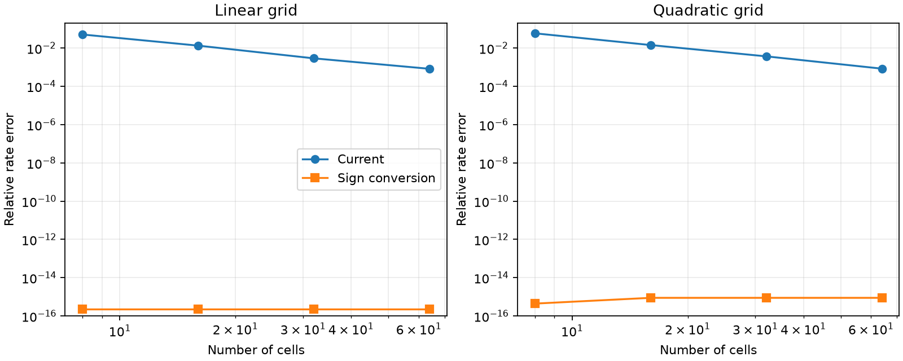
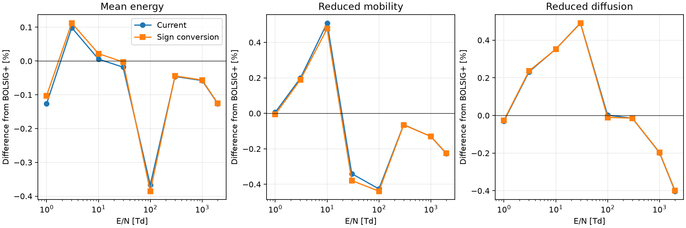

# Collision-integral reconstruction sign audit

Initial audit date: 2026-11-05. The initial investigation below used an
in-memory experimental variant without editing the package. Its original
records remain in `validation/collision_sign/`.

## Adopted correction

Following the audit, the current branch adopts `gj = -g[self.j]` in
`Process.scatterings()`. `_g()` retains its derivative definition and
`int_linexp0()` retains its reverse-coordinate integral contract. The new
`tests/test_collision_reconstruction.py` covers the helper, derivative sign,
nonflat interval reconstruction, rates, weighted rates, and collision-matrix
action for excitation, ionization, and attachment.

The suite now contains 106 tests. The BOLSIG+ notebook is re-executed using
the corrected production implementation. The reproducer explicitly names
its modes `legacy` and `corrected`: `corrected` uses production unchanged,
whereas `legacy` temporarily undoes the sign conversion. New numerical
records are written to `validation/collision_sign_corrected/`; the initial
audit results below are retained as historical evidence. In the tables below,
"Current" means the pre-fix implementation at the time of the initial audit.

## Initial finding

There was a sign inconsistency between the logarithmic derivative returned by
`BoltzmannSolver._g()` and the convention expected by `int_linexp0()`.
The integral helper itself implements its documented mathematical contract
correctly. The mismatch occurs when `Process.scatterings()` passes the
derivative to that helper without a sign conversion.

This conclusion follows from manufactured distributions and independent
integration, rather than from choosing the variant closest to BOLSIG+.

## Derivation and data flow

The local rate contribution for an incoming cell j is based on:

```text
k = gamma * integral E * sigma(E) * F(E) dE
g_j = d(log F)/dE evaluated near E_j
F(E) approximately equals F_j * exp(g_j * (E - E_j))
```

The factor E in the rate integrand follows from multiplying electron speed
`gamma*sqrt(E)` by the population weight `F(E)*sqrt(E)`.

The current `_g()` computes the derivative with increasing energy:

```python
g = np.log(Fp[2:] / Fp[:-2]) / (cenergyp[2:] - cenergyp[:-2])
```

For `F(E) = exp(s*E)`, it returns s, including at the endpoint cells for
this manufactured distribution. However, the helper contract is:

```text
int_linexp0(a, b, sigma_a, sigma_b, g, E_j)
    = integral sigma(E) * E * exp(g * (E_j - E)) dE
```

Passing the derivative unchanged reconstructs the opposite logarithmic slope.
The error is not canceled by a later operation: `rate()` multiplies these
integrals by `F[j]`, and `_PQ()` uses the same source-cell values in its matrix
action. The shifted collision grid determines outgoing indices; it does not
reverse the incoming energy coordinate or supply another exponential factor.

A consistent adapter, while retaining the helper's existing contract, is:

```python
# Correction in Process.scatterings(), subsequently adopted.
gj = -g[self.j]
```

Changing `_g()` to return the negative derivative instead could also convert
the convention, but would change that method's documented meaning. Applying
both changes would cancel the correction.

## Origin of the convention

The upstream BOLOS master sources inspected on the audit date contain the
same positive-derivative `_g()`, unchanged `gj = g[self.j]` handoff, and helper
exponent `g*(x0-x)`:

- [Upstream solver.py](https://github.com/aluque/bolos/blob/master/bolos/solver.py)
- [Upstream process.py](https://github.com/aluque/bolos/blob/master/bolos/process.py)

Thus this mismatch is inherited from the inspected upstream implementation;
it was not introduced by the Python 3 syntax conversion or the recently added
small-slope quadrature branch. These upstream links track master and may change;
the audit's numerical conclusions are tied to the local hashes in `summary.json`.

## Independent checks

### 1. Integral-helper contract

182 scalar cases and the corresponding vectorized call were checked against
SciPy adaptive quadrature. Cases include zero slope, slopes of both signs,
near-zero slopes, varying intervals, and linearly varying cross sections.
Zero-slope cases were also checked against polynomial integrals.

Maximum relative discrepancy: **3.05e-14**. Both the analytic-formula and
small-slope branches therefore agree with the helper's stated exponent.

For the earlier illustrative interval, with sigma = 1, s = -0.5,
E_j = 1.5, and bounds 1 to 2:

| Integral | Value |
| --- | ---: |
| Expected local reconstruction: integral E exp(s*(E-E_j)) dE | 1.47374623555521 |
| Current handoff: integral E exp(s*(E_j-E)) dE | 1.55760156614281 |
| Relative discrepancy for this interval | +5.68994% |

This interval discrepancy is not a prediction of the error in a complete
plasma calculation.

### 2. End-to-end manufactured rates and matrix action

72 configurations per variant were evaluated: linear and quadratic grids,
8/16/32/64 cells, slopes -0.5/0/+0.5, and excitation/ionization/attachment.
Cross sections are piecewise linear. The distribution is `exp(s*E)`, so the
logarithmic derivative is known exactly and there is no slope-estimation error.

Rates were compared against closed-form exponential-polynomial antiderivatives,
cross-checked by adaptive quadrature. Matrix action was independently assembled
from quadrature on cached intervals. The same clipped integration domain was
used for both variants and the independent calculation.

| Maximum relative discrepancy | Current handoff | Sign-converted handoff |
| --- | ---: | ---: |
| Integrated rate | 7.3916% | 1.11e-15 |
| Collision-matrix action, normalized L1 discrepancy | 26.9298% | 2.06e-15 |

For the matrix metric, the denominator is the larger of the exact matrix-action
L1 norm and the target-fraction-weighted exact rate. This avoids magnifying
near cancellation. Electron-number balance was separately checked in both
variants; balance alone does not establish reconstruction accuracy.

Both variants agree for flat distributions. On the tested nonflat distributions,
the current rate error decreases under refinement, so the presence of the
mismatch does not imply that finely resolved results have order-one errors.



## Real-data impact and comparison with BOLSIG+

The included Phelps cross sections and original BOLSIG+ 07/2024 export were
read directly. Eight exported fields were used: 1, 3.05519, 10.0095, 29.9011,
99.914, 300.038, 1001.37, and 2000 Td. Composition is N2:O2 = 80:20 at 300 K.

Each field was solved in both variants at 600 and 1200 quadratic cells,
giving **32 converged final solutions**. Both variants use an identical
initial guess, gas conditions, resolution, and cutoff at each comparison.
The cutoff is the larger of 20 times the BOLSIG+ mean energy and 1.25 times
the final exported EEDF energy. This fixed, reference-based cutoff isolates
the sign change from a change in the cutoff-selection procedure.

These settings differ slightly from the existing `validate_bolsig.ipynb`,
which uses a preliminary BOLOS mean energy to select its cutoff. Its saved
results have not been overwritten.

### Change in BOLOS results caused by the sign conversion

| Maximum absolute percentage change | 600 cells | 1200 cells |
| --- | ---: | ---: |
| Reconverged mean energy / mobility*N / diffusion*N | 0.0388% | 0.0104% |
| Reconverged selected rates | 0.9179% | 0.2194% |
| Selected rates evaluated on the identical current distribution | 1.2217% | 0.3161% |

Selected reactions are C2, C4, C21, C25, C28, C31, C37, and C43. For these
relative-change statistics, current BOLOS rates at or below 1e-25 m3/s are
excluded. Absolute values for all 43 processes remain in the CSV files.

The same-distribution comparison isolates the reconstruction change; the
reconverged comparison additionally includes the response of the distribution.

### Agreement with the archived BOLSIG+ output

| Cells | Variant | Max. absolute transport/mean-energy difference | Max. EEDF weighted L1 | Max. selected-rate difference |
| ---: | --- | ---: | ---: | ---: |
| 600 | Current | 0.5091% | 0.4966% | 13.3084% |
| 600 | Sign converted | 0.4899% | 0.5202% | 13.7800% |
| 1200 | Current | 0.5027% | 0.5311% | 13.9724% |
| 1200 | Sign converted | 0.5009% | 0.5340% | 14.1287% |

Transport here includes mean energy, reduced mobility, and reduced diffusion,
not the derived D/mu ratio. EEDF differences are integrated on the reference
samples with the population weight sqrt(E), without independent normalization.
Selected-rate percentages exclude BOLSIG+ reference rates at or below
1e-25 m3/s. Tiny rates can have large relative discrepancies; this statistic
is not an application-specific significance criterion.

The maximum selected-rate discrepancy remains O2 ionization C43 at
29.9011 Td. The sign conversion does **not** remove that difference; at 600
cells it changes the rate from approximately 4.04866e-24 to 4.02664e-24 m3/s,
whereas BOLSIG+ reports 4.67019e-24 m3/s.



The mathematical sign correction therefore does not uniformly improve
agreement with the archived reference. Other discretization, interpolation,
threshold, and model differences remain. These checks do not establish the
cause of the remaining C43 discrepancy, nor do they rerun BOLSIG+ or prove
historical input identity. A closer match to this reference is not the criterion
used to decide the reconstruction sign.

## Scope and recommendation

The evidence supports converting the derivative's sign at the helper boundary
if `Process.scatterings()` is to implement the documented local exponential
reconstruction. The helper's mathematical contract should remain unchanged.
The adopted correction is accompanied by permanent nonflat manufactured
rate/operator regression tests and regeneration of affected numerical records.

The pre-fix sources were fingerprinted before and after the initial audit
and were unchanged during that investigation. The sign conversion changes
neither the energy-shift
mapping nor the zero/nonfinite-slope fallback. Tiny negative tails may remain;
the audit checks convergence, finite distributions, and normalization, not
unconditional positivity. Runtime warnings are recorded. Solver log messages
are suppressed during this audit to keep its output compact, so the absence
of console warnings must not be read as a warning-free calculation.

## Reproduction and artifacts

From the repository root, use the same Python environment as the package:

```console
python validation/verify_collision_sign.py --skip-solver
python validation/verify_collision_sign.py
```

The first command checks the helper and manufactured operators. The second
also recomputes both solver variants. NumPy and SciPy are required. The updated
script writes numerical records to `validation/collision_sign_corrected/`:

- `summary.json`: environment, source/input hashes, and aggregate results
  for the full run (`helper_summary.json` for `--skip-solver`).
- `helper_integrals.csv`: 182 independent helper comparisons.
- `manufactured_operators.csv`: 72 configurations for each of the two variants.
- `transport.csv`, `rates_all_43.csv`, `eedf_metrics.csv`: reconverged comparisons.
- `same_distribution_rates.csv`: reconstruction-only rate changes.
- `solver_diagnostics.json`: convergence, normalization, minimum samples, and
  captured runtime warnings.

The figures in this document visualize the initial audit. Numerical CSV/JSON
files in the new directory are regenerated by the commands above; the initial
figures and records remain snapshots of the pre-fix investigation.
